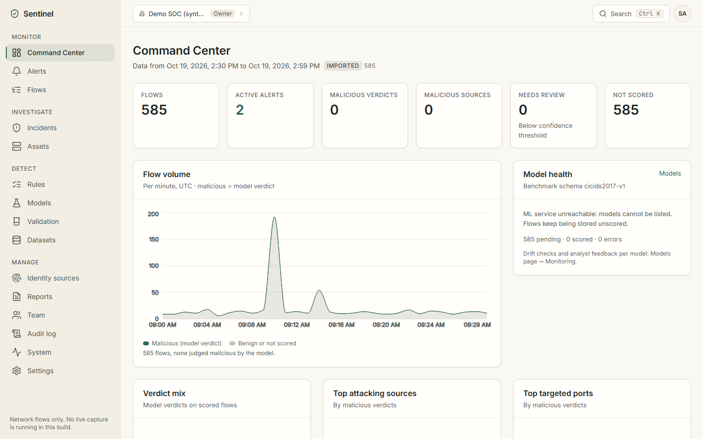
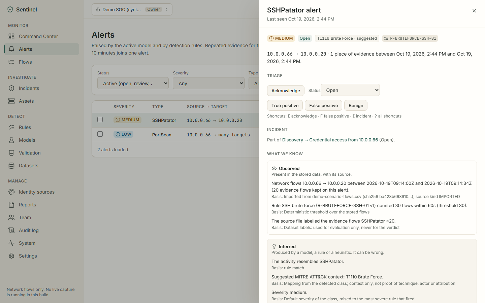
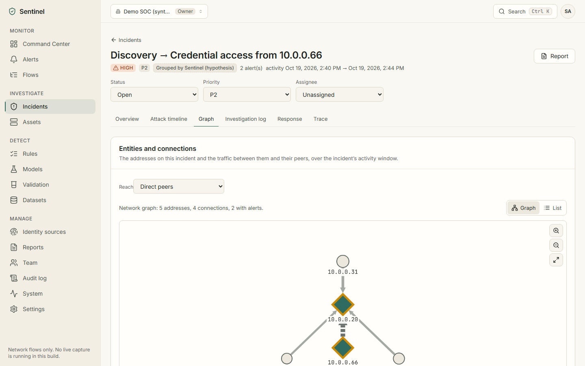
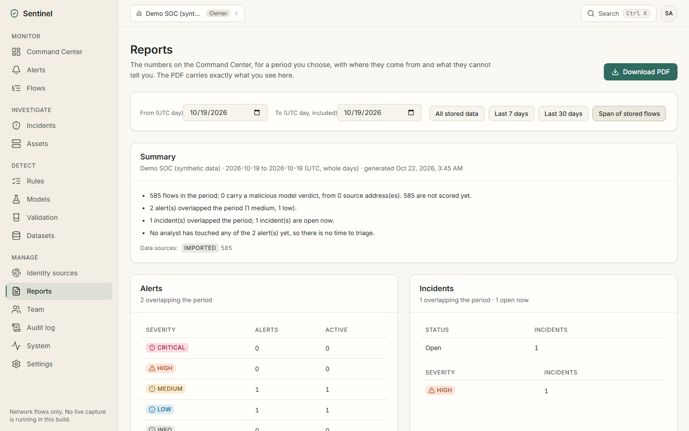
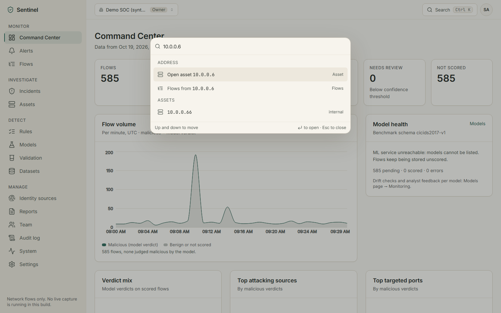
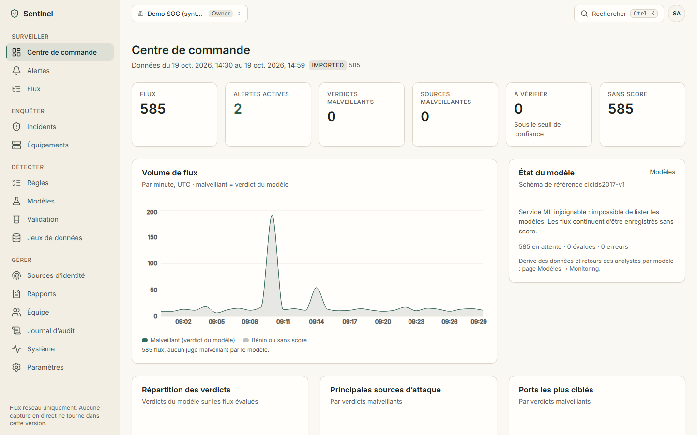

# Sentinel

**Explainable network threat detection and triage for small security teams.**

Sentinel stores network flows, scores them with a served machine-learning model, explains every
verdict, and gives analysts a place to investigate. It is built to be honest about what it does:
every verdict comes from a model you can inspect (never from a dataset label), every record shows
where it came from, and every model ships with per-class results and its known limits.

> **Status (October 2026): working foundation.** CSV import, real ML scoring with SHAP explanations,
> drift checks and novelty flags, detection rules, alerts with evidence-based analysis and noise
> controls, correlation into incidents, an attack timeline and entity graph, response guidance
> (recommend and simulate only), incident and executive reports (PDF), an asset inventory, identity
> attribution from imported records, validation runs, durable background jobs, multi-tenant orgs with
> invitations, secure auth with optional two-factor, RBAC and an audit log work end to end and are
> tested. Live capture, integrations (webhooks, VPN / AD / EDR connectors) and any enforcement are
> **not built**; see [ROADMAP.md](ROADMAP.md).

**For the expo:** [one-page pitch](docs/PITCH.md) · [demo script](docs/DEMO.md) ·
[evaluation report](docs/EVALUATION.md) (every number measured, with what it does not show).

## Screenshots

Synthetic DEMO scenario imported on a throwaway stack (`npm run docs:screenshots -w @sentinel/e2e`);
no ML service runs there, so both alerts come from rules and the model card says so.

| | |
|---|---|
|  Command Center: provenance badge, KPIs, model health |  An alert: observed, inferred and unknown, kept apart |
|  Incident graph: attacker, target and peers |  Executive report (also as PDF) |
|  Ctrl+K: pages, addresses, ids |  The interface in French |

## What works today

| Area | What you can do |
|---|---|
| Import | Upload a CICIDS2017 / CICFlowMeter CSV (or use the CLI for large files). Header checked first; every rejected row counted and sampled; labels kept as ground truth only; flows tagged `IMPORTED`. |
| Detection | The org's active model (per feature schema) scores pending flows through the ML service. No active model → flows stay "not scored". Unknown classes are errors, never mapped. |
| Rules | Five starter threshold rules (port scan, SSH/FTP brute force, SYN flood, slow HTTP) plus your own, as JSON with a plain-language description; enable, edit (versioned, audited) and test them over stored flows without creating alerts. |
| Alerts | Raised by model verdicts and rule hits, deduplicated (same source, target, type within 10 minutes → one alert with a count), hybrid severity, `needs review` for low confidence; triage with status and analyst verdict. |
| Noise controls | Settings → Detection (Owner / Admin; every role can read): a minimum model confidence below which verdicts stay on their flows but raise no alert, and an allowlist of trusted addresses or networks (each with a reason) that raise no model or rule alert. Kept-out verdicts are counted by reason; every change is audited. Starter rules whose default was revised (slow HTTP) are upgraded only if never customised, with an audit entry giving the reason. |
| Explanations | Top-5 SHAP contributions per malicious or low-confidence verdict, class probabilities, confidence with a needs-review threshold, MITRE ATT&CK technique marked "suggested". |
| Models | Registry of trained versions with model card, macro-F1, per-class precision/recall/F1/support, holdout on unseen source IPs, library-version checks, per-org activation (Owner/Admin). |
| Evaluation | Live comparison of verdicts with dataset labels in your org (confusion matrix, macro-F1), with a warning when the data was also used for training. |
| Evidence | Each alert separates what was **observed** (stored data and its file), what was **inferred** (model, rule or heuristic, with its basis) and what is **unknown**, and shows its provenance (dataset SHA-256, model and rule versions) and change history. |
| Incidents | Alerts from the same source within the org's correlation window (default 15 min) are grouped into one incident, labelled a hypothesis; open incidents from one or several alerts or from scratch. Incident page: attack timeline in event time (facts vs hypotheses, MITRE marked "suggested"), append-only investigation log (who did what, when), status / priority / assignee, a *Trace* tab (import → detection → triage → investigation → response → report, with who and when) and a printable report that includes it. |
| Response | Per-class checks and containment ideas, blocklist **simulations** (iptables, nftables, CSV) that are never applied, and actions *reported* by analysts. Sentinel cannot block, isolate or change a firewall, and says so. |
| Assets | Inventory of addresses seen in flows: services accepted, peers, activity over time, alerts, notes, and a history of changes (new or vanished services, estimate changes, inactive / seen again, note edits) that ignores scan noise. Device type is a low-confidence estimate from ports, labelled as such, or "unknown" with what would help. |
| Identity | Import VPN / DHCP / auth / EDR / directory records (CSV). Attribution shows each matching record with its source, validity window and graded confidence, flags ambiguity, and says "unknown" (and what would help) when nothing matches. An IP is never presented as proof of identity. Look up an account, hostname or MAC to see the addresses it held, when, and the alerts on those addresses in those windows (each lookup is audited). |
| Validation | Test a model version or a rule version on a labelled dataset: per-class precision / recall / F1 / support, false-positive and false-negative samples (with SHAP for models), dataset hash, training-overlap check, author and time. Results are stored and immutable. |
| Investigation | Flow explorer with URL filters; entity graph (Cytoscape) on asset and incident pages with a list alternative; command palette (Ctrl+K) and G-then-letter shortcuts; incident board with keyboard and mouse drag and drop, every move audited. |
| Reports | Executive report for a period (same numbers as the dashboard, time to triage, quality on labelled data, provenance, limitations) and incident reports, both as server-generated PDFs. |
| Model monitoring | Drift check per model version (PSI per feature against the training reference), analyst feedback per model, "unusual behaviour" flag from an optional novelty detector (never an attack class). Rebuild existing alerts under new noise settings, keeping analyst work. |
| Organisations | Multi-tenant orgs, roles Owner / Admin / Analyst / Viewer enforced server-side, invitation links, member removal with last-Owner safeguards, optional TOTP two-factor sign-in with recovery codes, append-only audit log, sessions, data export, account deletion. |
| Operations | Durable background jobs (BullMQ on Redis, or in-process without it) with retries and dead letters; System page; per-org data retention (off by default); minute rollups for dashboards; OpenAPI at `/api/docs`; optional Prometheus `/metrics`. |
| Language | English and French for navigation, sign-in, the Command Center, the search palette and Settings; other pages are English for now, and the language setting says so. |

## Architecture

```
 Browser (React SPA) ──/api/v1──▶ API (Node 22+, Express, TypeScript) ──▶ MongoDB
                                     │  auth, RBAC, tenancy, import, stats, audit
                                     ├──▶ Redis (optional): BullMQ job queue, workers in the API or in src/worker.ts
                                     └──/predict──▶ ML service (FastAPI, scikit-learn, SHAP)
                                                     model registry = services/ml/artifacts/
```

Monorepo (npm workspaces): `apps/web`, `apps/api`, `packages/shared` (taxonomy, label normaliser,
severity and MITRE maps, feature schemas, RBAC matrix, zod contracts), `services/ml`,
`services/collector` (placeholder). Details: [docs/ARCHITECTURE.md](docs/ARCHITECTURE.md).

## Quick start on Windows (PowerShell)

The step-by-step, verified version (configuration table, accounts, tour, tests, troubleshooting) is
[docs/WINDOWS_GUIDE.md](docs/WINDOWS_GUIDE.md).

Prerequisites: Node.js 22+, Python 3.11+, MongoDB (local install or Docker). If PowerShell blocks
`npm.ps1`, use `npm.cmd` as below.

```powershell
npm.cmd install
Copy-Item apps/api/.env.example apps/api/.env
# Edit apps/api/.env: set MONGO_URI and JWT_ACCESS_SECRET (generate one with the command in the file).
npm.cmd run ml:install          # Python venv for the ML service
npm.cmd run ml:train:sample     # trains the small benchmark model (writes services/ml/artifacts/)
```

Then, in two terminals:

```powershell
npm.cmd run ml:serve            # ML service on http://127.0.0.1:8000
npm.cmd run dev                 # API on http://localhost:4000 and web on http://localhost:5173
```

Open http://localhost:5173 (use `localhost`, not `127.0.0.1`: the CSRF origin check uses the
allow-list in `CORS_ORIGINS`). **There is no default account**: create one at `/register` (you become
the Owner of a new, empty workspace), import `data/samples/cicids2017-friday-ddos-sample.csv` on the
Datasets page, activate the model on the Models page, and the flows get scored.

### Demo workspace (synthetic, tagged DEMO)

```powershell
npm.cmd run seed:demo                 # dry run: prints the target database and what it would create
npm.cmd run seed:demo -- --yes        # creates it and prints three accounts with random passwords, once
```

It adds one organisation (`sentinel-demo`) with an Owner, an Analyst and a Viewer
(`owner@` / `analyst@` / `viewer@sentinel-demo.test`), 585 synthetic flows tagged DEMO (office
traffic, a port scan, then an SSH brute force from `10.0.0.66`), the rule alerts, the correlated
incident, assets and identity records. It never modifies existing data and refuses to run twice.
Passwords are shown only in that output. Follow the tour in
[docs/WINDOWS_GUIDE.md](docs/WINDOWS_GUIDE.md#6-a-five-minute-tour-demo-workspace-signed-in-as-the-analyst);
the data is explained in [data/demo/README.md](data/demo/README.md).

Check the whole chain from the command line (creates and then deletes a throwaway account; use a
development database):

```powershell
npm.cmd run smoke
```

## Docker

```powershell
Copy-Item .env.example .env      # set JWT_ACCESS_SECRET and ML_SERVICE_TOKEN
docker compose --profile train run --rm ml-train   # train the sample model inside the pinned ML image
docker compose up --build        # http://localhost:8080
```

One-command demo (stack + sample model + synthetic DEMO workspace):

```powershell
docker compose --profile demo up --build
docker compose --profile demo logs demo-seed   # the three sign-in accounts, printed once
```

The `demo` profile adds two one-shot services: `ml-train-demo` trains the small sample model into the
stack's own volume (skipped when it exists) and `demo-seed` creates the DEMO workspace in the stack's
own MongoDB (it refuses any other host). It is idempotent and never activates a model: activate the
sample model on the Models page, then run scoring. `docker compose --profile demo down -v` resets it.

MongoDB is not published on the host, so the stack does not collide with a local MongoDB on 27017.

## Coming from the old `cyber-dashboard`

The old JavaScript backend copied each dataset label into the "prediction" and generated incidents
with invented assignees. The new API never reads those fields. Existing data stays untouched and
invisible until you migrate it:

```powershell
npm.cmd run migrate:legacy                  # dry run: prints what would change, writes nothing
npm.cmd run migrate:legacy -- --apply       # back up first (mongodump); idempotent; deletes nothing
```

The migration attaches legacy users to a "Legacy workspace" org (bcrypt passwords keep working and
are upgraded to argon2id at next login), recomputes ground-truth labels and timestamps from the
stored raw rows, moves the copied predictions under `legacy.*`, leaves the random `seed.js` flows
invisible, and flags the invented incidents. Migrated flows are then scored by the active model.

## Commands

| Command | Purpose |
|---|---|
| `npm run dev` | API + web in watch mode |
| `npm run typecheck` / `lint` / `test` / `build` | all TypeScript workspaces |
| `npm run ml:install` / `ml:train:sample` / `ml:serve` / `ml:test` | ML service (cross-platform) |
| `npm run import:csv -- --org <slug> "<file.csv>"` | import a large CSV from disk (`--demo` tags it DEMO) |
| `npm run migrate:legacy [-- --apply]` | migrate data from the old backend |
| `npm run smoke [-- http://host:port]` | end-to-end check against a running stack |
| `npm run demo:data` | regenerate the synthetic DEMO scenario files in `data/demo/` (no database access) |
| `npm run seed:demo [-- --yes] [-- --mongo-uri <uri>]` | create the isolated demo workspace (dry run without `--yes`) |
| `npm run e2e:install` then `npm run test:e2e` | Playwright end-to-end and accessibility suite (own throwaway stack) |
| `npm run docs:screenshots -w @sentinel/e2e` | regenerate the README screenshots on the same throwaway stack |
| `npm run bench -w @sentinel/api -- --flows 3000000 --dbpath <empty dir>` | dashboard benchmark on its own throwaway mongod ([docs/PERFORMANCE.md](docs/PERFORMANCE.md)) |

## Testing

Counts from the merged `main` on 2026-10-22, all passing:

- `packages/shared`: 105 unit tests (label normaliser incl. shared vectors, maps, RBAC matrix, feature
  schema drift, feature glossary, rules DSL, CIDR parsing, attribution grading, device estimates,
  knowledge base, blocklist syntax).
- `apps/api`: 197 tests, most of them integration tests on a real in-memory MongoDB: configuration,
  auth (rotation, reuse detection, logout-all, CSRF, rate limit, TOTP, legacy hash upgrade), tenant
  isolation, RBAC role × route matrix, audit per mutation, import (incl. retried and crashed jobs),
  scoring, alert claims, stats and rollups, noise controls and alert rebuild, drift and feedback,
  novelty, correlation, incidents and trace, response simulations, reports and PDFs, assets, identity,
  validation runs, invitations and members, retention, OpenAPI coverage, metrics, security headers and
  upload hardening. 3 more BullMQ tests run against a real Redis in CI (skipped locally without
  `SENTINEL_TEST_REDIS_URL`).
- `apps/web`: 94 tests (Testing Library): API client, evidence and attribution panels, graph view,
  command palette and shortcuts, incident board, reports, detection tuning and rebuild, monitoring
  panel, translations (key and placeholder parity, French sign-in page), UTF-8 source check.
- `e2e` (Playwright, Chromium): 18 journeys: the analyst journey on the DEMO scenario (alert →
  observed / inferred / unknown → DHCP attribution → triage → incident → timeline → blocklist
  simulation → report → investigation log), tokens absent from web storage, the graph, palette and
  board, reports and PDFs, invitation and two-factor sign-in, the System page, detection tuning,
  switching to French, no horizontal scroll at 375 px, and axe (WCAG 2.1 A/AA) with no serious
  violation in light and dark themes. The suite starts its own API on an in-memory MongoDB (ports
  4310 / 5310) and never loads `apps/api/.env`. First run: `npm.cmd run e2e:install` downloads Chromium
  (about 720 MB on disk under `%LOCALAPPDATA%\ms-playwright`).
- `services/ml`: 60 pytest tests (artefacts, honest metrics, predict contract, schema and version
  mismatch, SHAP reconstruction, day-wise holdout, drift reference, novelty detector).

Continuous integration (`.github/workflows/ci.yml`) runs all of the above plus the Docker build on
every push to `main` and every pull request. On GitHub (private repository `s-doumbia-cyber/sentinel`,
2026-10-20): run #1 on `main` (780d5b5) and runs #2 and #3 on pull request #1 passed all five jobs
(Node 22, Node 24, ML, end-to-end, Docker).

## Honest limitations

**Not built or not connected** (the UI and the API say so where it matters):

- **No live network capture.** Flows come from CSV import only (upload or `import:csv`). The
  collector, the ingest API with API keys, the native feature schema and the lab dataset are Phase 2.
- **No VPN, Active Directory or EDR connector.** Identity context comes only from CSV exports you
  import on the Identity sources page.
- **No blocking, isolation or firewall change.** Sentinel recommends, generates blocklist
  *simulations* that it never applies, and records actions analysts report doing themselves.
- **No outbound notifications** (webhooks, Slack, email) and no live stream (SSE).

Other limits:

- **The bundled model is a toy benchmark.** Trained on 990 rows of one CICIDS2017 capture (BENIGN vs
  DDoS, one attacker IP): macro-F1 1.00 on a random split but 0.52 on unseen source IPs. It says
  nothing about other attacks or your network. The full-dataset benchmark and its limits are in
  [docs/EVALUATION.md](docs/EVALUATION.md); CICIDS2017 has known label errors and does not transfer to
  other networks.
- Identity attribution only knows what you import. Correlation groups alerts by source address and
  time; it is a hypothesis, not attribution.
- The demo scenario is synthetic. Rules catch it by construction; the bundled model (BENIGN vs DDoS
  only) scores the SSH brute-force flows as benign. Neither says anything about a real network.
- Rule windows are evaluated per import (or on "Run detections") over stored flows, not in real time.
- Dashboards use minute rollups but still take about 2 s at 3 million flows; the 300 ms target is not
  met ([docs/PERFORMANCE.md](docs/PERFORMANCE.md)).
- French covers part of the interface; Hindi is not translated.
- CICIDS2017 timestamps are stored as recorded (no timezone; afternoon files use a 12-hour clock).

## Documentation

[ROADMAP.md](ROADMAP.md) (plan, progress, decisions) · [docs/CHANGELOG.md](docs/CHANGELOG.md) ·
[docs/PRODUCT_SPEC.md](docs/PRODUCT_SPEC.md) · [docs/ARCHITECTURE.md](docs/ARCHITECTURE.md) ·
[docs/ML_AND_DETECTION.md](docs/ML_AND_DETECTION.md) · [docs/DESIGN_SYSTEM.md](docs/DESIGN_SYSTEM.md) ·
[docs/EVALUATION.md](docs/EVALUATION.md) · [docs/PERFORMANCE.md](docs/PERFORMANCE.md) · [docs/SECURITY_ASVS.md](docs/SECURITY_ASVS.md) ·
[docs/DEMO.md](docs/DEMO.md) · [docs/PITCH.md](docs/PITCH.md) ·
[services/ml/README.md](services/ml/README.md) · original project docs in `docs/legacy/`.
